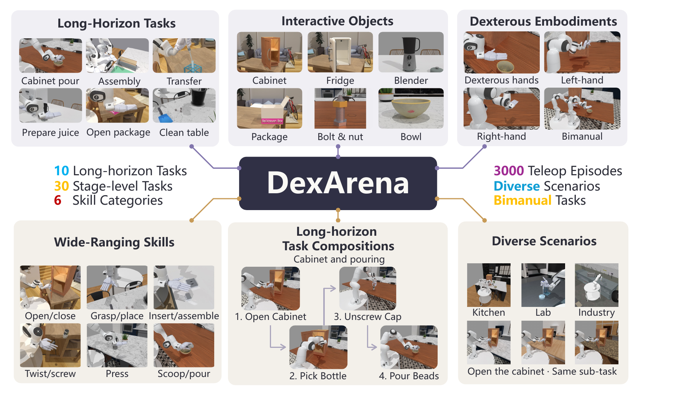

<a id="top"></a>

<p align="center">
  
</p>

<h1 align="center">DexArena</h1>
<p align="center"><strong>A Unified Benchmark for Long-Horizon Dexterous Manipulation</strong></p>

<p align="center">
  <a href="https://sipair-elastic.github.io/DexArena-website/"></a>
  <a href="https://arxiv.org/abs/2611.02629"></a>
  <a href="https://huggingface.co/datasets/SIPAIR/DexArena"></a>
  <a href="https://sipair-elastic.github.io/DexArena-website/leaderboard/"></a>
  <a href="docs/GETTING_STARTED.md"></a>
</p>

<p align="center">
  <a href="#news">📰 News</a> &nbsp;·&nbsp;
  <a href="#overview">✨ Overview</a> &nbsp;·&nbsp;
  <a href="#resources">🔗 Resources</a> &nbsp;·&nbsp;
  <a href="#documentation">📚 Documentation</a> &nbsp;·&nbsp;
  <a href="#citation">📝 Citation</a>
</p>

DexArena evaluates **dexterous skills, cross-scene generalization and long-horizon
task composition** in a shared simulation benchmark built on SAPIEN and ManiSkill.
This repository provides task environments, demonstration processing tools, and
baseline training and evaluation code.

<p align="center">
  🧩 <strong>10</strong> long-horizon tasks &nbsp;·&nbsp;
  🎯 <strong>30</strong> stage tasks &nbsp;·&nbsp;
  🎮 <strong>3,000</strong> demonstrations &nbsp;·&nbsp;
  🤖 <strong>4</strong> end effectors
</p>

<a id="news"></a>

## 📰 News

- **2026-11-06** — Updated [baseline training and evaluation guides](train/TRAIN_EVAL.md), including released ACT / Diffusion Policy checkpoints and the [GR00T](docs/GROOT_DEXARENA.md) and [π0.5](docs/PI05.md) workflows. See the [code update](https://github.com/Qhf7/DexArena/commit/c284d4d61d645bfff7366e21c33a08f548f69506).
- **2026-11-03** — [Paper v2](https://arxiv.org/abs/2611.02629v2) is available on arXiv.
- **2026-11-02** — Introduced DexArena in the [arXiv preprint](https://arxiv.org/abs/2611.02629v1).

<a id="overview"></a>

## ✨ Overview

<p align="center">
  <a href="assets/readme/overview.png"></a>
</p>

<p align="center"><em>From individual dexterous skills to complete manipulation sequences.<br>Select the figure to view it at full resolution.</em></p>

- 🧩 **Composable tasks** — 10 long-horizon sequences spanning everyday manipulation, assembly and liquid handling, decomposed into 30 stage tasks.
- 🤖 **Multiple embodiments** — Sharpa, Wuji, XHand and the Franka parallel-jaw gripper, with left-arm, right-arm and bimanual tasks.
- 🎮 **Replay-validated demonstrations** — 3,000 successful Sharpa demonstrations, with 100 episodes per stage task and tools for review, validation and multi-view rendering.
- 🧪 **Three evaluation tracks** — stage execution, cross-scene generalization and long-horizon composition, with six paper baselines: PPO, RLPD, ACT, Diffusion Policy, GR00T N1.7 and π0.5.

Explore the [task catalog](https://sipair-elastic.github.io/DexArena-website/tasks/)
or inspect the [task IDs and horizons](docs/GETTING_STARTED.md#tasks).

<a id="resources"></a>

## 🔗 Resources

| Resource | What you will find |
| :--- | :--- |
| 🌐 [Project website](https://sipair-elastic.github.io/DexArena-website/) | Benchmark overview, task previews and research links |
| 📄 [Paper](https://arxiv.org/abs/2611.02629) · [PDF](https://arxiv.org/pdf/2611.02629) | Benchmark design, experiments and findings |
| 🤗 [Dataset and assets](https://huggingface.co/datasets/SIPAIR/DexArena) | Demonstrations, task-object meshes and dataset metadata |
| 🧠 [Baseline checkpoints](https://huggingface.co/datasets/SIPAIR/DexArena/tree/main/ckpt) | Released weights for the six baseline families |
| 📊 [Leaderboard](https://sipair-elastic.github.io/DexArena-website/leaderboard/) · [Evaluation protocol](https://sipair-elastic.github.io/DexArena-website/leaderboard/#evaluation) | Paper results, comparisons, metrics and evaluation settings |
| 💻 [Official upstream](https://github.com/SIPAIR-Elastic/DexArena) | Official benchmark code repository |
| 📝 [BibTeX](docs/citation.bib) | Downloadable citation for research use |

> [!NOTE]
> **Data access:** request access once on the Hugging Face dataset page
> (approval is automatic), then run `hf auth login` before downloading.
> The leaderboard displays the paper's baseline results; community submissions
> are not currently open.

<a id="documentation"></a>

## 📚 Documentation

Start with **[Getting started →](docs/GETTING_STARTED.md)** for cloning,
installation, asset downloads, task IDs and your first environment.

| Guide | What it covers |
| :--- | :--- |
| 🚀 [Installation and task reference](docs/GETTING_STARTED.md) | Environment setup, repository layout, all 40 tasks and dataset downloads |
| 🏋️ [Train and evaluate](train/TRAIN_EVAL.md) | RL baselines, ACT, Diffusion Policy, configurations and released-checkpoint evaluation |
| 🦾 [GR00T N1.7](docs/GROOT_DEXARENA.md) · [π0.5](docs/PI05.md) | Model setup, data preparation, fine-tuning and evaluation |
| 🎮 [Recordings and datasets](data_gen/recordings/README.md) | Episode storage, review, export and integrity certificates |
| ✅ [Replay validation](data_gen/replay/README.md) · [Multi-view rendering](data_gen/render/README.md) | Validate demonstrations and render videos from recorded states |
| 🌍 [Cross-scene evaluation](docs/howto_cross_scene_eval.md) | Shared evaluation setup for the 30 stage tasks |
| 🎨 [Scene randomization](docs/howto_randomize_scene.md) · [Scene library](docs/howto_scene_library.md) | Backgrounds, materials, lighting and scene configuration |
| 📷 [Camera setup](docs/camera_setup/README.md) · [Task instructions](docs/DEX_TASK_INSTRUCTIONS.md) | Camera rigs and language-instruction conventions |

<a id="citation"></a>

## 📝 Citation

If you use DexArena in your research, please cite our
[paper](https://arxiv.org/abs/2611.02629). [Download BibTeX](docs/citation.bib).

```bibtex
@misc{ping2026dexarena,
  title = {DexArena: A Unified Benchmark for Long-Horizon Dexterous Manipulation},
  author = {Haonan Ping and Jianshu Hu and Yimin Wang and Yi Zhu and Pai Liang and Qiyan Jin and Qirui Bao and Ying Qian and Xinyang Ding and Hongfei Qiao and Tianle Xue and Yucheng Bai and Soo Wei Jie and Shuguang Li and Yutong Ban},
  year = {2026},
  eprint = {2611.02629},
  archivePrefix = {arXiv},
  primaryClass = {cs.RO},
  doi = {10.48550/arXiv.2611.02629},
  url = {https://arxiv.org/abs/2611.02629}
}
```

## 🙏 Acknowledgements

DexArena builds on [SAPIEN](https://github.com/haosulab/SAPIEN),
[ManiSkill](https://github.com/haosulab/ManiSkill) and
[LeRobot](https://github.com/huggingface/lerobot).
Some robot models come from [dex-urdf](https://github.com/dexsuite/dex-urdf).
We thank their authors and maintainers for making these tools available.

## ⚖️ License

Code is released under the [Apache License 2.0](LICENSE).
See the [Hugging Face dataset card](https://huggingface.co/datasets/SIPAIR/DexArena)
for data usage terms.

<p align="center">
  <a href="https://github.com/Qhf7/DexArena/issues">🐛 Report an issue</a> &nbsp;·&nbsp;
  <a href="https://github.com/Qhf7/DexArena/pulls">🤝 Contribute</a> &nbsp;·&nbsp;
  <a href="#top">↑ Back to top</a>
</p>
