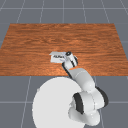
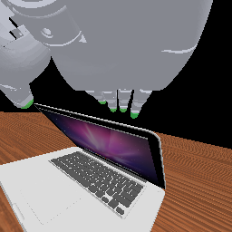

# Fixed Base and Wrist Camera Configuration

The fixed parameters are defined in
[`utils/camera_configs.py`](../../utils/camera_configs.py) under version
`z1p08_overhead20_back40cm_v1`. This directory contains only documentation
and reference images.

## OpenLaptop camera views

The images below show the same state from one `OfficeDeskOpenLaptop-Sharpa-v1`
demonstration. They were rendered directly with the fixed configuration as
256 x 256 RGB images.

| Base camera | Wrist camera |
| --- | --- |
|  |  |

The source is `raw_state_sequence[60]` from
`OfficeDeskOpenLaptop-Sharpa-v1/replay/source_02e99e4f812c077`.
The images have no cropping, resizing, or text overlays.

## Relationship to existing camera configuration

`build_dexarena_base_camera` remains the compatibility builder used by existing
tasks; its legacy defaults are intentionally unchanged. The current OpenPI
PI0.5 baseline uses the fixed policy-camera profile. New image-policy tasks
should use the accepted fixed builders and configuration below:

- `DEXARENA_FIXED_BASE_CAMERA_CONFIGS`: fixed world-frame poses for Office,
  Cabinet, and PackageOpening.
- `DEXARENA_FIXED_WRIST_CAMERA_CONFIG`: fixed wrist-camera intrinsics and local
  extrinsics.
- `WRIST_MOUNT_BY_TASK` (formerly `DEXARENA_FIXED_WRIST_MOUNT_BY_TASK`, still
  available under that name): the left or right wrist link used by each task.
- `build_dexarena_fixed_base_camera(scene)` and
  `build_dexarena_fixed_wrist_camera(mount=...)`: builders that convert these
  parameters into ManiSkill `CameraConfig` objects.

**Newer work uses the per-long-task registry instead.** `FAMILY_CAMERA_RIGS`
holds one base camera per long task (`cabinet`, `package_opening`, `office`,
`screwing`, `drawer_plug`), built with `build_family_base_camera(family)`, and
`resolve_wrist_camera_mount(robot, env_id)` resolves the mount flange; the pixel
stack (`utils.pixel_env.install_pixel_env`) declares the wrist camera on it at
runtime, so the task files keep their own sensors. Note that `DEXARENA_FIXED_BASE_CAMERA_CONFIGS["office"]` documented
here is the **superseded** office pose: it frames the laptop (the reference image
in this directory is an OpenLaptop frame, which is why the gap went unnoticed)
but leaves the keyboard out of frame and renders the mouse at ~3 px. The current
office pose is `FAMILY_CAMERA_RIGS["office"]`.

The fixed image-policy wrist camera and the Sharpa/Wuji robot integrations use
the same calibrated local extrinsics, from `SHARPA_WRIST_CAMERA_V1` in
`utils.camera_configs` (it used to live in `utils.marvin_wrist_camera_config`,
which was merged into `utils.camera_configs` and deleted). Existing registered
agents retain their 640 x 360 runtime sensor contract; the accepted image-policy
builder changes only the sensor output, to 256 x 256 with a 90-degree vertical
FOV. This keeps the Marvin calibration as the single source of truth for wrist
extrinsics.

## Fixed imaging parameters

| Parameter | Base | Wrist |
| --- | --- | --- |
| Sensor name | `base_camera` | `task_wrist_camera` |
| Resolution (width x height) | 256 x 256 | 256 x 256 |
| Vertical FOV | 90 degrees | 90 degrees |
| Near / far planes | 0.01 / 100 m | 0.01 / 2 m |
| Coordinate frame | World | Wrist-link local frame |

The base-camera height is fixed at world-frame z = 1.08 m. The camera image
plane is 20 degrees from the tabletop. Equivalently, the optical axis is 20
degrees from the downward table normal and 70 degrees from the tabletop.

| Scene | Eye (world frame) | Target (world frame) |
| --- | --- | --- |
| Office, including OpenLaptop | `(-0.626326980708465, -0.05, 1.08)` | `(-0.2623567464422627, -0.05, 0.08)` |
| Cabinet | `(-0.3904819657242641, 0.1, 1.08)` | `(-0.12114399236727436, 0.1, 0.34)` |
| PackageOpening | `(-0.3904819657242641, 0.1, 1.08)` | `(-0.12114399236727436, 0.1, 0.34)` |

For every scene, the base camera is placed behind the task target along the
world-frame negative X direction. The Office camera is 0.40 m farther back
than the initial 20-degree configuration.

The fixed wrist-camera local extrinsics are:

```text
eye     = ( 0.06000000000000000, 0,  0.01200000000000000)
forward = (-0.17364817766693033, 0,  0.98480775301220800)
up      = (-0.98480775301220800, 0, -0.17364817766693033)
target  = eye + forward
```

## Usage

Build the base camera by scene name:

```python
from utils.camera_configs import build_dexarena_fixed_base_camera

base_camera = build_dexarena_fixed_base_camera("office")
```

For the wrist camera, resolve the mount link from the task ID and pass the
link to the builder:

```python
from mani_skill.utils import sapien_utils
from utils.camera_configs import (
    DEXARENA_FIXED_WRIST_MOUNT_BY_TASK,
    build_dexarena_fixed_wrist_camera,
)

task_id = "OfficeDeskOpenLaptop-Sharpa-v1"
mount_name = DEXARENA_FIXED_WRIST_MOUNT_BY_TASK[task_id]
mount = sapien_utils.get_obj_by_name(self.agent.robot.get_links(), mount_name)
if mount is None:
    raise RuntimeError(f"Missing wrist camera mount {mount_name!r}")
wrist_camera = build_dexarena_fixed_wrist_camera(mount=mount)
```

The task's `_default_sensor_configs` should return
`[base_camera, wrist_camera]`. For policies that use image history, use the
current frame, the frame two steps earlier, and the frame four steps earlier,
with the base camera before the wrist camera. Disable guidance markers when
creating the environment so they do not appear in policy inputs.
