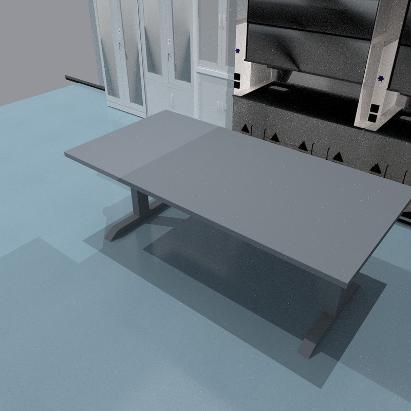

# LabUtopia laboratory with an empty work table

`labutopia_lab003` is the laboratory from the reviewed pipette preview, registered
through the same `SceneSpec` / `FullSceneBuilder` / background-adapter interface
as the existing scene library. It contains LabUtopia's room, floor and fixed
cabinetry, plus one grey ManiSkill work table. **The background contains no task
props**: no pipette, stand, sample cup, drying oven, graduated cylinder or flasks.
The selected task creates its own objects when it is loaded.



## Prepare the assets

The simulator consumes GLB files and does not require Isaac Sim or USD at runtime.
Prepare the room once with Python 3.11 and the conversion dependencies below;
this can be a separate environment from ManiSkill.

```bash
python -m pip install usd-core==26.8 trimesh==5.1.0 pillow==12.3.0 \
  numpy==2.4.6 scipy==1.17.1 fast-simplification==0.2.0
export MS_ASSET_DIR=/path/to/.maniskill
./scripts/scene_library.sh fetch-labutopia
```

The downloader fetches only the pinned lab_003 room dependencies (about 116 MB),
verifies every input's SHA256, and converts `/World/lab_015`. It writes the room
GLB (about 22 MB), mesh bounds, attribution and conversion provenance under
`$MS_ASSET_DIR/data/scene_datasets/glb_scenes/labutopia_lab003/`.
`ROBODEX_SCENE_GLB_DIR` overrides that root for both preparation and simulation.
No large scene assets are checked into this repository.

For an existing download, pass its `lab_003` directory; hashes are still checked:

```bash
./scripts/scene_library.sh fetch-labutopia \
  --source /path/to/LabUtopia/assets/chemistry_lab/lab_003
```

The preparation script can also run directly, without importing the simulator:
`python tasks/scene_builders/fetch_labutopia_scene.py --out /path/to/glb_scenes`.

## Use the scene

The shared factory also accepts the lab for the 30 canonical dexterous subtasks:

```python
from utils.dex_scene_eval import make_scene_eval_env

env = make_scene_eval_env(
    "PipetteTransferAspirateLiquid-Sharpa-v1",
    scene_background="labutopia_lab003",
    obs_mode="rgb",
)
obs, info = env.reset(seed=17)
```

This is an optional background in `AVAILABLE_BACKGROUND_IDS`. The published
three-kitchen `BACKGROUND_IDS` and its 90-combination evaluation matrix remain
unchanged. The factory keeps the task's robot reset and object placements;
it disables the old table and ground, installs the lab room and empty work table,
and aligns the working edge at every reset. Its manifest identifies this as
`prepared_workspace`, since the foreground table is supplied by ManiSkill.

## Geometry and rendering

The room floor is at z=0. The work surface and workstation origin are at
z=0.9196429 m; yaw is 0, so the robot approaches along +X. The room's placement
matches the approved preview. Its simplified room mesh has static triangle-mesh
collisions. The table uses the collection table's mesh, scale and support box,
with 0.30 friction and zero restitution. A solid support box represents the table;
the visible legs are not separate collision geometry.

Run these commands in the ManiSkill environment on a GPU/Vulkan-capable machine:

```bash
# Empty table, no robot or task objects; writes close.png and right_rear.png.
./scripts/scene_library.sh labutopia-preview --shader rt --out output/lab_empty

# The same lab with only the aspirate task's objects and robot.
./scripts/scene_library.sh labutopia-preview \
  --env-id PipetteTransferAspirateLiquid-Sharpa-v1 --shader rt --out output/lab_pipette

ROBODEX_TEST_LABUTOPIA=1 python -m pytest -q \
  tests/test_labutopia_scene.py tests/test_scene_backgrounds.py \
  tests/test_robodex_camera_configs.py
```

`--shader rt` uses the ray-traced appearance of the reviewed preview; omit it
for the faster default renderer. `--spp` controls ray-tracing samples per pixel.
`--denoiser oidn` optionally enables denoising when sufficient GPU memory is available.

The smoke checks cover room clutter, task-table support, trolley clearance,
camera images, short physics steps and reproducible resets. They do not measure
policy success. MDL shaders are approximated with glTF PBR materials; transparent
surfaces and lighting can differ from LabUtopia's original Isaac Sim rendering.

## Source and attribution

Room asset: [Rui-li023/LabUtopia](https://github.com/Rui-li023/LabUtopia),
revision `8df72784265c375a327ffa3f0a0cf8c676f229a7`,
`assets/chemistry_lab/lab_003/lab_003.usd`, room subtree `/World/lab_015`.
The upstream assets are licensed under
[CC BY-NC 4.0](https://creativecommons.org/licenses/by-nc/4.0/).
Our changes select the room subtree, simplify its meshes and convert USD/MDL to
GLB/PBR. The work table is the existing ManiSkill asset. Generated assets retain
an attribution file and a pinned source manifest.
