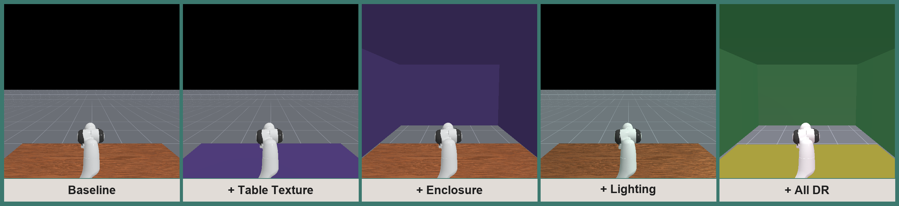
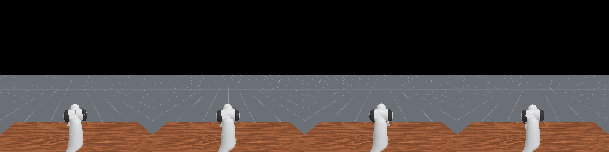
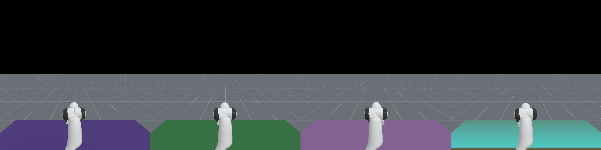
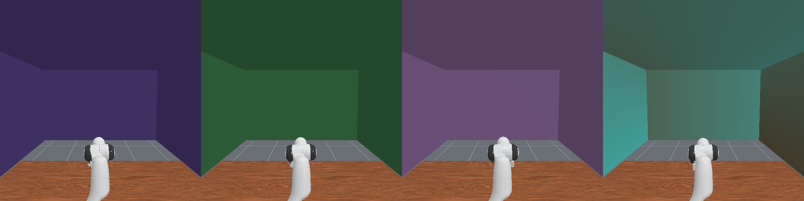
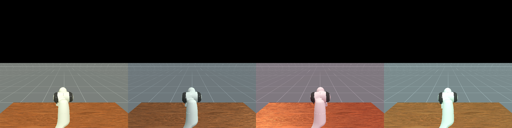
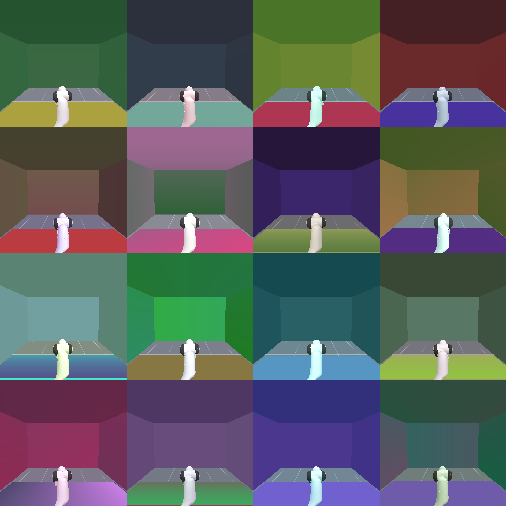
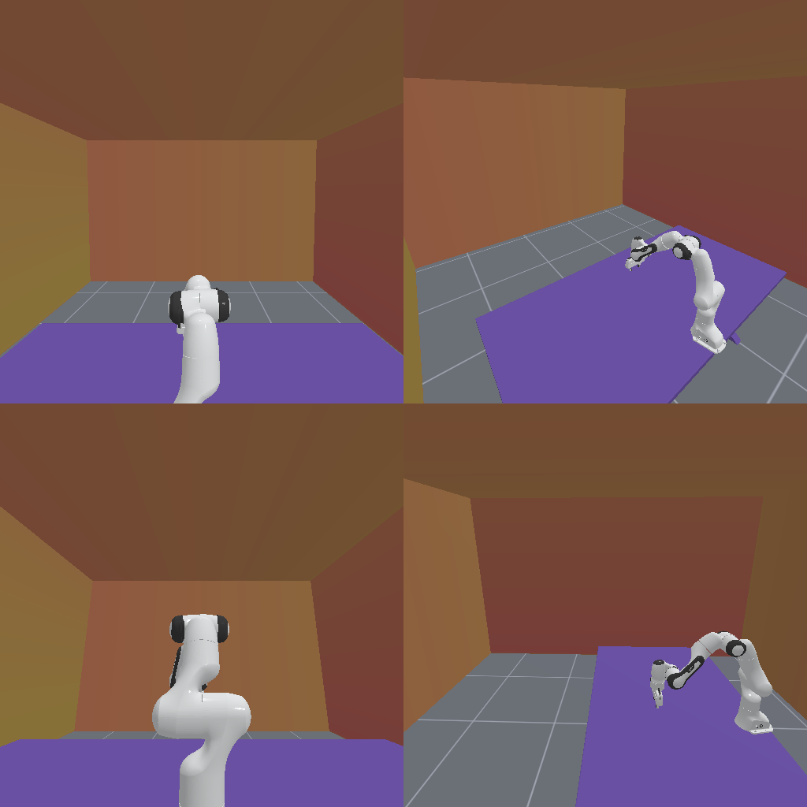

# How-to: randomize the scene for a task

This guide swaps the default `TableSceneBuilder` for `RandomizedTableSceneBuilder`
to apply domain randomization on the table and background. Each axis is opt-in;
defaults are inert (behavior matches `TableSceneBuilder`).

For the other approach — putting the workstation inside a real authored interior
(RoboCasa kitchen, ReplicaCAD apartment, Objaverse workshop) instead of a
procedural room — see [howto_scene_library.md](howto_scene_library.md). The two
share the lighting randomizer; the scene library drops the rest.

## Gallery

Each DR axis stacked on top of the baseline scene (one sub-env per panel):



Per-axis sample grids (4 sub-envs each):

| Baseline | + Table texture | + Wall | + Lighting |
| :---: | :---: | :---: | :---: |
|  |  |  |  |

All axes combined (`random_table_height` + `random_table_texture` +
`random_background` + `random_lighting` + camera jitter), 16 sub-envs:



The background enclosure (four walls + ceiling) from four camera angles — same
room, different viewpoints:



## 1. Swap the builder

In your task's `_load_scene`:

```python
from tasks.scene_builders import RandomizedTableSceneBuilder

def _load_scene(self, options):
    self.table_scene = RandomizedTableSceneBuilder(
        env=self,
        random_table_height=0.03,    # max downward jitter in meters
        random_table_texture=True,   # per-sub-env table-top texture
        random_background=True,      # textured wall behind the table
    )
    self.table_scene.build()
```

Existing tasks already store the builder on `self.table_scene`, so swapping the
class is enough.

## 2. Read the table-height offset when placing actors

The builder shifts the table actor on each reset; it does **not** move
task-added actors. To keep an object planted on the table, read the per-env
offset:

```python
def _initialize_episode(self, env_idx, options):
    self.table_scene.initialize(env_idx)
    z_off = self.table_scene.table_top_offsets[env_idx]
    # Apply z_off to every actor you place on the table.
    self.bottle.set_pose(pose_with_z_shift(z_off))
```

When `random_table_height=0.0`, `table_top_offsets` is a zero tensor and adding
it is a no-op — your task code stays the same with or without jitter.

## 3. Switch obs_mode to rgbd

Visual randomization only helps the policy if it can see it. Train with image
observations:

```python
env = gym.make("YourTask-v1", obs_mode="rgbd", ...)
```

## 4. Background enclosure

`random_background=True` surrounds the workstation with **four walls + a
ceiling** (the floor is the ManiSkill ground plane). All five surfaces share one
texture per sub-env, resampled every reset. The enclosure is centered on
`room_center` with interior half-extents `room_half_size = (x, y, z)`:

```python
RandomizedTableSceneBuilder(
    env=self,
    random_background=True,
    room_center=(0.3, 0.0, 0.7),      # box center (x, y, z)
    room_half_size=(1.7, 1.6, 1.0),   # interior half-extents; ceiling at cz + z
    wall_thickness=0.02,
)
```

Size the room so your render/observation cameras sit **inside** it, otherwise
they look at the enclosure from the outside. The walls have **no collision
shape** — the robot can pass through them. This is deliberate, to avoid spurious
contacts when the robot overshoots.

## 5. Texture library

By default, 100 procedurally generated PNGs (50 solid colors + 50 gradients)
are cached at `~/.maniskill/data/scene_textures/v1/` on first use. To swap in
a real-texture library:

```python
RandomizedTableSceneBuilder(
    env=self,
    random_table_texture=True,
    texture_dir=Path("/path/to/my/textures"),
    n_textures=500,
)
```

Any directory of `.png` files works. The builder loads up to `n_textures` of
them in lexical order.

## 6. Known limitations

1. **Task cooperation required for height jitter** — see step 2.
2. **Fixed clutter** — object count and positions do not change between resets.
   Only appearance (texture / lighting) and table height are re-randomized;
   spawning distractor objects is out of scope (see step 9).
3. **Procedural textures only** — solid colors and gradients. See step 5 to
   swap in real textures.

## 7. Lighting DR

Enable per-sub-env ambient + directional light randomization:

```python
RandomizedTableSceneBuilder(
    env=self,
    random_lighting=True,
)
```

Each sub-env gets an independent ambient color in `[0.1, 0.6]^3` and one
directional light with randomized direction (forced downward) and a warm/cool
tint. Re-sampled on every reset.

Tune the ranges via the `ambient_range`, `tint_range`, and `light_down_bias`
constructor kwargs if the defaults don't suit your task.

## 8. Camera pose DR

The builder doesn't own cameras — your env's `_default_sensor_configs` does.
Use the `jitter_pose` helper:

```python
from tasks.scene_builders import jitter_pose

class MyTask(BaseEnv):
    @property
    def _default_sensor_configs(self):
        rng = np.random.default_rng(0)
        pose = jitter_pose(
            base_eye=[0.5, 0.0, 0.4],
            base_target=[0.0, 0.0, 0.1],
            eye_range=0.05,    # +/- 5 cm on each axis
            target_range=0.02,
            num_envs=self.num_envs,
            rng=rng,
        )
        return [CameraConfig("base_camera", pose, 128, 128, np.pi/2, 0.01, 100)]
```

Pose is sampled once at env construction. For per-reset camera jitter, build
a kinematic mount actor and re-pose it in `_initialize_episode` (see ManiSkill
DR tutorial).

## 9. Per-reset re-randomization

Since v2, table texture, wall texture, and lighting are re-sampled on every
`env.reset(...)`. A single sub-env's appearance therefore varies across
episodes. Texture indices live in `builder._table_tex_idx` and
`builder._wall_tex_idx` (per-sub-env `np.int64`) and update in-place during
`initialize()`.

Caveat: actor positions / number of actors do not change between resets —
clutter/distractor objects require a separate spawning mechanism (planned).
