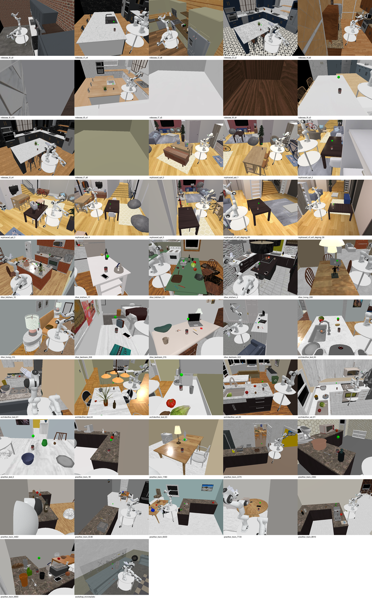
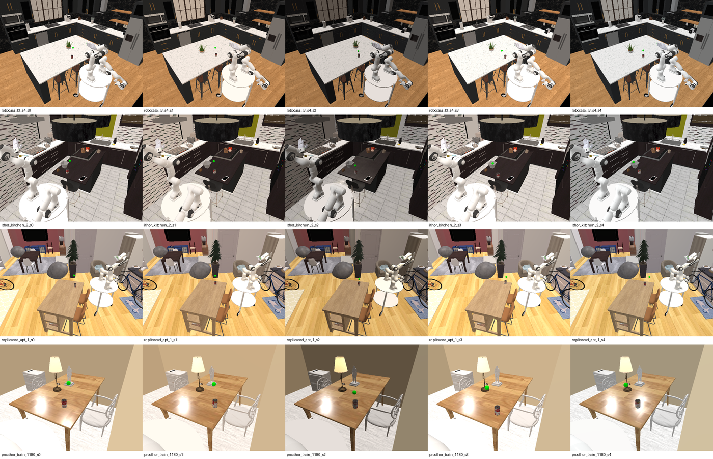

# How-to: run a task inside a full indoor scene

`RandomizedTableSceneBuilder` randomizes a synthetic room — procedural textures
on the table top, a five-sided box around it. `FullSceneBuilder` takes the other
route: it puts the rig in real authored interiors (RoboCasa kitchens, AI2THOR
rooms and houses, ReplicaCAD apartments, static Objaverse meshes) and works on
**the surface that scene
already has** — a kitchen counter, an island, a dining table. The
[LabUtopia laboratory](howto_labutopia.md) instead includes a prepared empty work
table matching the collection rig. Of the old randomization axes it keeps only the
ones a real interior does not already provide.

| Axis | Synthetic room | Full scene |
| --- | :---: | :---: |
| table-top texture | yes | dropped — the surface is the scene's own |
| wall/ceiling enclosure | yes | dropped — the scene *is* the enclosure |
| table height jitter | yes | dropped — but surface height varies *across* scenes |
| lighting | yes | **kept** (`random_lighting=True`), rewritten — see below |
| camera jitter | yes | **kept** (`tasks.scene_builders.jitter_pose`) |



## The workstation frame

Tasks are written in a frame whose origin sits on the work surface, exactly as
with ManiSkill's `TableSceneBuilder`. The builder decides where that frame lands
(`anchor_pose`) and hands tasks the transforms to follow it. Its **+x points from
the robot into the surface**, so the open floor the rig stands on is at -x.

| Call | Use |
| --- | --- |
| `world_pose(local)` | a fixed workstation-local pose |
| `world_pose_from_pq(p, q, env_idx)` | batched per-episode placements |
| `mount_actor` / `mount_pose(pose)` | cameras, so they follow the workstation |
| `anchor_pose.inv() * pose` | world -> workstation, for observations |
| `robot_root_pose` | where the trolley stands, height corrected per surface |

With no scene selected the anchor is identity and every one of these is a no-op,
so the same task code runs unchanged on the bare table.

## Wiring a task

The pattern, in a task's `_load_scene`. Four things change:

```python
def _load_scene(self, options):
    if self.scene_id is None:
        self.table_scene = TableSceneBuilder(env=self, ...)
    else:
        self.table_scene = FullSceneBuilder(
            env=self,
            scene_ids=self.scene_id,
            random_lighting=self.scene_random_lighting,
            robot_reach=-float(self._robot_root_pose.p[0]),
        )
    self.table_scene.build()
```

1. **Placements** go through `_ws_pose` / `_ws_pose_pq` instead of raw world
   poses — the object and the goal.
2. **The robot root** comes from `_robot_root_world()`: on the bare table the arm
   is bolted to the top, in a scene the trolley stands on the floor, and how far
   its deck clears the surface depends on how high that surface is.
3. **Cameras** are mounted on `table_scene.mount_actor` with `mount_pose`.
4. **Observations** are mapped back with `_to_ws`, so a policy sees the same
   numbers in every scene.

Rewards and success need no changes: they are all distances between placed
objects, which a rigid anchor transform leaves alone.

### Surface height

The trolley deck is `CART_HEIGHT` = 0.9196 m above the floor, which is exactly
ManiSkill's table height — the carts were built to match it. So a ~0.92 m kitchen
counter puts the arm at the height it was tuned for, and a 0.76 m dining table
leaves it mounted 16 cm high, reaching down. The builder works this out per
scene; tasks never see it.

## Lighting

`random_lighting=True` resamples ambient and one key light per reset, both from
the episode RNG, so a seed reproduces them.

Colour is drawn as a **temperature** (2700 K tungsten to 6500 K overcast
daylight) mapped onto the black-body curve, not as three independent channel
gains. The first version scaled R, G and B independently; rendering it for the
first time showed green and magenta rooms, hues no light source emits. Fixing it
both removed the unreal variation and widened the real one:

| | pixel diff | brightness range | hue drift |
| --- | ---: | ---: | ---: |
| independent RGB | 12.7 | 116–129 | 0.415 |
| colour temperature | **15.9** | **97–128** | **0.089** |

(mean over 5 seeds of `robocasa_l3_s4`; `--seeds 0,1,2,3,4 --random-lighting`.)



The scene datasets light themselves, so this rides on top of their lighting
rather than replacing it.

## The library

`tasks/scene_builders/scene_library.py` holds 51 `SceneSpec`s:

| Source | Count | Configs |
| --- | :---: | --- |
| `ai2thor` | 29 | 12 iTHOR rooms, 6 ArchitecTHOR houses, 11 ProcTHOR houses |
| `robocasa` | 12 | one style per kitchen layout |
| `replicacad` | 8 | `apt_0..5` plus two staging variants |
| `glb` | 1 | Objaverse "Minimalistic Workshop Environment" (industrial) |
| `labutopia` | 1 | lab_003 laboratory, empty grey work table |

Most of the variety comes from AI2THOR: iTHOR contributes single rooms by type
(kitchen, living room, bedroom), ProcTHOR 12k procedurally furnished houses of
which a deterministic spread is taken. RoboCasa and ReplicaCAD are deliberately
capped — 120 RoboCasa configs are all kitchens, and all 90 ReplicaCAD configs
are the same apartment shell with the furniture moved.

```python
from utils.dex_scene_eval import make_scene_eval_env
make_scene_eval_env("CabinetPouringOpenCabinet-Sharpa-v1", scene_background="robocasa_l3_s1")
```

## Anchors

Each spec carries an `anchor` of `(x, y, surface_z, yaw)` or `"auto"`.

* **RoboCasa** `auto` walks the counters' *reset regions* — the flat top pieces
  RoboCasa itself places objects on, already split around sink and cooktop
  openings — discards any that still fall under an appliance, and keeps the
  largest one with floor in front of it. RoboCasa's own robot placement is not
  usable here: it parks in front of a randomly chosen appliance, which puts the
  workspace in the sink or on the burners.
* **ReplicaCAD and AI2THOR** `auto` match furniture by name
  (`frl_apartment_table_01`, `Dining_Table`, `Countertop`, `Desk`), drop what is
  outside working height (coffee tables), take the largest top, and pick which of
  its four sides to work from. Names are the only semantics these datasets carry.
* **Static meshes** cannot be `auto` at all: the whole room is one mesh with no
  parts to query. Measure with `./scripts/scene_library.sh surfaces` and write the
  anchor down.

### Why rays, not bounding boxes

Both "which side of this table" and "where should the render camera stand" are
answered by raycasting the collision geometry. Bounding boxes cannot answer
them: ReplicaCAD ships an entire apartment as one stage mesh, so every wall
collapses into a single box covering the floor plan, and a box-based free-space
search happily reports the void *outside the building* as the roomiest spot in
the scene — which is where the first version of this put the robot. A ray stops
at the wall.

The robot is loaded before scene builders run, so it is already in the scene and
would block its own probes; the builder parks it out of range while measuring.

## Rendering a scene

`labutopia-preview` renders one task inside the LabUtopia laboratory, and
`utils.dex_scene_eval.make_scene_eval_env` builds any of the 30 stage tasks in the three
kitchens (see `docs/howto_cross_scene_eval.md`):

```bash
./scripts/scene_library.sh labutopia-preview --env-id CabinetPouringOpenCabinet-Sharpa-v1 --out output/lab
```

**On the Slurm cluster the renderer needs a GPU job.** A login node has no
render device (`Failed to find a supported physical device`), and `$HOME` does
not exist on every compute node, so the asset root has to be explicit — note
that `MS_ASSET_DIR` is the `.maniskill` root, ManiSkill appends `data` itself
(`scene_library.sh` derives `ROBODEX_SCENE_GLB_DIR` from it):

```bash
cat > render.sh <<'HEREDOC'
#!/bin/bash
export MS_ASSET_DIR=/mnt/ceph2/$USER/home/.maniskill
cd /path/to/DexArena
./scripts/scene_library.sh labutopia-preview --env-id CabinetPouringOpenCabinet-Sharpa-v1 --out /mnt/ceph2/$USER/lab
HEREDOC
sbatch --gres=gpu:2 -c 8 -o render.%j.log render.sh   # from a compute node
```

## Assets

ReplicaCAD, RoboCasa and AI2THOR come from ManiSkill:

```bash
python -m mani_skill.utils.download_asset ReplicaCAD RoboCasa AI2THOR
```

Behind a slow link, fetch the zips from `https://hf-mirror.com/datasets/haosulab/...`
and unpack them into `$MS_ASSET_DIR/scene_datasets/`. RoboCasa is 3.7 GB zipped
and 8 GB on disk; AI2THOR is 14 GB zipped. `aria2c -x16` is worth it — a single
connection to the mirror ran at 0.1 MB/s where 16 ran at 11 MB/s.

Static meshes come from Objaverse, keyed by the uid in the Sketchfab URL:

```bash
./scripts/scene_library.sh fetch <uid> --endpoint https://hf-mirror.com
```

Objaverse exports are y-up in arbitrary units, so `scale`/`euler` in the spec
have to be set per model by looking at a render.

## Do not import this from the package `__init__`

`tasks/scene_builders/__init__.py` deliberately does not re-export anything from
here. Collection-target modules import the package rather than the module, and an
environment's code fingerprint is the hash of its AST import closure, so a name
added there lands in their closures and re-versions their datasets — the cost is
a re-collection. `lighting.py` duplicates the axis that also lives inside
`randomized_table.py` for the same reason.

The tools here are leaves — nothing imports them, so they are outside every
closure. After touching anything under `tasks/scene_builders/`, run the restoration
and replay checks in `data_gen/replay/` on a recorded dataset; they fail if the
scene a collection target builds has changed.

## Limits

* **One dataset per vectorized env.** The upstream builders build for every
  sub-env in a single call, so sub-envs cannot mix sources — nor mix AI2THOR's
  four registries, since those are separate builders. Different configs *within*
  one dataset are fine.
* **CPU rendering.** On a host without a Vulkan ICD, SAPIEN falls back to
  software rendering; a kitchen scene takes ~25 s to build and render.
